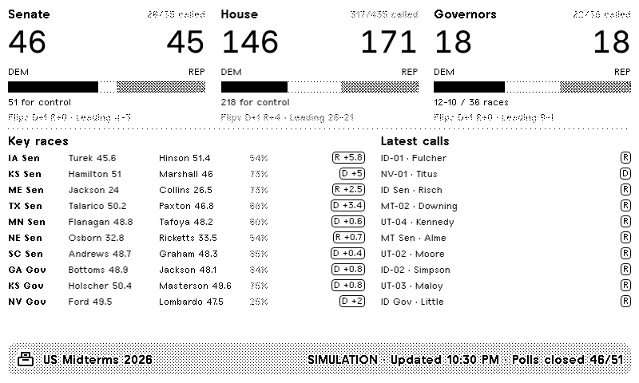

# US Midterms 2026 — plugin TRMNL

Résultats en direct des élections de mi-mandat américaines du 3 novembre 2026 sur TRMNL OG et TRMNL X : Sénat, Chambre des représentants, gouverneurs, courses clés, derniers résultats, sièges qui basculent et vue par État. Interface en anglais ou en français.

## Écrans (option « Screen »)

| Écran | Contenu |
|---|---|
| Overview | Les 3 chambres (sièges D/R, barre, nombre de courses attribuées, bascules, candidats en tête), courses clés, derniers résultats. Avant la fermeture des bureaux : compte à rebours. |
| Senate / House / Governors | Grille de sièges (100 / 435 / 50), majorité, vote populaire pour la Chambre, liste des courses (les plus serrées en premier). |
| Battleground | Toutes les courses serrées du Sénat et des gouverneurs, plus les courses indécises de la Chambre. |
| Latest calls | Les 12 derniers résultats annoncés, avec l'heure et les bascules. |
| My state | Sénat et gouverneur de l'État choisi, plus le détail de sa délégation à la Chambre, district par district. |
| Rotate | Change d'écran toutes les 10 minutes. |

Les quatre tailles TRMNL sont gérées (plein écran, demi horizontal, demi vertical, quart), avec des versions adaptées au TRMNL X.

## Source des données

Les résultats viennent de l'Associated Press, via le flux JSON public publié par The New York Times (`static01.nyt.com/elections-assets/pages/data/2026-11-03/results-*.json`). Ce flux n'est pas une API officielle : c'est très bien pour un usage perso, mais vérifie les conditions d'utilisation avant d'en faire une recette publique.

Le script `scripts/build.mjs` réduit ces ~9 Mo de données en 51 petits fichiers (`us.json` + un par État) publiés sur la branche `data`.

## Installation (sans terminal)

1. **Crée le dépôt** `trmnl-midterms` sur github.com (public), puis *Add file → Upload files* et glisse-dépose tout le contenu du dossier. Si le dossier `.github` ne passe pas (fichiers cachés), utilise *Add file → Create new file*, tape `.github/workflows/update.yml` comme nom et colle le contenu du fichier.
2. **Settings → Actions → General → Workflow permissions** : coche *Read and write permissions*, puis *Save*.
3. **Actions → Update results → Run workflow** (laisse `0`) : en 1 minute, la branche `data` est créée.
4. Sur TRMNL, crée un **Private Plugin** :
   - Strategy : *Polling*
   - Polling URL : `https://raw.githubusercontent.com/nbbou81000/trmnl-midterms/data/{{ focus_state }}.json`
   - Form fields : colle le bloc `custom_fields` de `trmnl/settings.yml`
   - Markup : colle `trmnl/shared.liquid` dans *Shared*, puis chaque fichier `full`, `half_horizontal`, `half_vertical`, `quadrant` dans l'onglet correspondant.
   - Refresh : le plus court disponible (15 min).

## Calendrier des mises à jour (automatique)

- **3 nov., 23h50 (heure de Paris)** : mode « soirée électorale », mise à jour toutes les 2 minutes pendant ~6 h.
- **4 nov., 5h40** : deuxième session de 6 h (Ouest, Alaska, Hawaï).
- **Du 3 au 10 nov.** : toutes les 10 minutes. **Ensuite, jusqu'à fin novembre** : toutes les heures.
- Pour forcer : *Actions → Update results → Run workflow*. Mets par exemple `120` pour enchaîner deux heures de mises à jour toutes les 2 minutes.

Les tâches planifiées de GitHub peuvent prendre 5 à 20 minutes de retard aux heures chargées. Si rien n'a bougé à 0h15, lance le workflow à la main avec `350`.

## Lecture de l'écran

- Noir = démocrates, trame grise = républicains, blanc / carrés vides = sièges non attribués.
- `D +2.4` encadré : en tête de 2,4 points (pas encore annoncé). Étiquette noire `R wins` : élu selon l'AP. `FLIP` / `BASCULE` : le siège change de parti.
- Le pourcentage gris indique la part du vote attendu déjà dépouillée.
- Sénat : il faut 51 sièges aux démocrates, 50 aux républicains (le vice-président JD Vance départage).
- `*` après un État : élection partielle (Ohio, Floride).

## Aperçu local

`node scripts/build.mjs --demo 0.5 --out demo` génère une soirée simulée (0 = fermeture des premiers bureaux, 1 = fin de nuit) pour tester les gabarits. Les captures du dossier `preview/` en sont issues.
